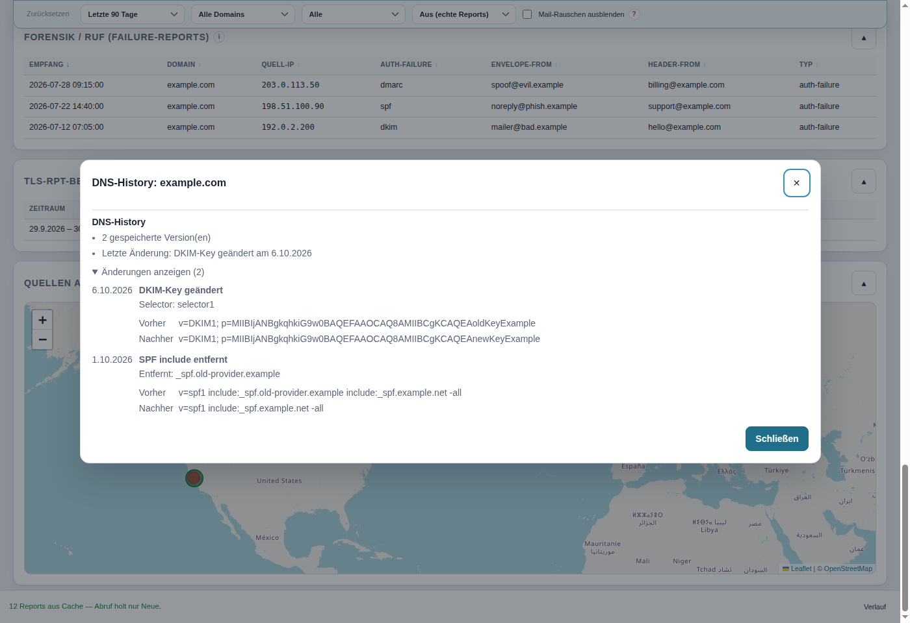
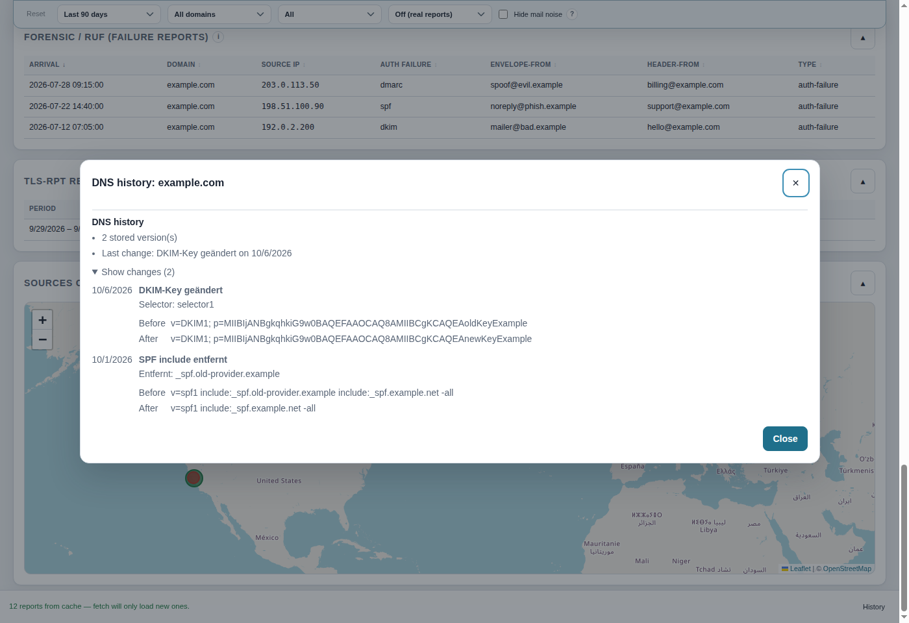

# Changelog

## Unreleased — changes since v1.0.44

### English

- Added deeper DKIM key inspection in the DNS check: detects revoked keys (`p=` empty), key algorithm (`rsa` / `ed25519`), RSA modulus length in bits (warning on keys ≤ 1024 bits), and testing mode (`t=y`).
- Added live BIMI asset validation: checks the SVG logo (`l=`) against the SVG Tiny Portable/Secure (SVG Tiny PS) profile (≤ 32 KB, `baseProfile="tiny-ps"`, `<title>`, no scripts or forbidden elements) and validates the VMC/CMC certificate (`a=`) expiration window.
- Added DNSSEC `AD`-bit validation and RFC 1035 TCP fallback (`TC=1`) to DANE/TLSA lookups, warning when TLSA records are published without DNSSEC.
- Added local cryptographic DKIM signature verification (`bh=` body hash and `b=` signature verified against live `_domainkey` DNS keys) to the **Inspect email** tool.
- Improved IMAP fetch robustness: tracks mailbox `UIDVALIDITY` (resetting the UID watermark if a folder is recreated) and includes `TLS-RPT` / `TLS Report` subjects in the default search filter.
- Capped concurrent IP enrichment lookups (`IP_ENRICHMENT_CONCURRENCY = 8`), reduced `dns:healthBatch` IPC payload to pre-aggregated domain stats, and restricted `disableHardwareAcceleration` / `--disable-gpu` workarounds to Linux.
- Modularized `src/shared/i18n.ts` (`locales/de.ts`, `locales/en.ts`), `src/main/cache.ts` (`cache-dns.ts`, `cache-enrichment.ts`), and `src/renderer/src/view.ts` (`domain-settings-modal.ts`, `diagnosis-modal.ts`, `tlsrpt-view.ts`).
- Added permanent per-domain DNS and transport history, recording snapshots and detecting DMARC, SPF, DKIM, BIMI, TLS-RPT, and MTA-STS changes.
- Added automatic daily DNS and transport checks for domains found in saved DMARC reports. Existing recent checks are reused, and failures are logged and reported.
- Added a per-domain info button in the domain health list to open DNS history, including event dates and before/after values. The history is also available from the DNS check view.
- Refined report correlations to reflect the latest DNS drift and the latest DMARC report, avoiding stale alerts when the fail rate has recovered.
- Updated vulnerable transitive development dependencies: `http-cache-semantics` to 4.3.0 and `source-map-js` to 1.2.2; overrode `roarr` to 3.1.3 to remove vulnerable `sprintf-js`.

### Deutsch

- Tiefere DKIM-Schlüsselprüfung im DNS-Check ergänzt: erkennt widerrufene Schlüssel (`p=` leer), Algorithmus (`rsa` / `ed25519`), RSA-Schlüssellänge in Bit (Warnung bei ≤ 1024 Bit) und den Testmodus (`t=y`).
- Live-Validierung für BIMI ergänzt: prüft das SVG-Logo (`l=`) gegen das SVG-Tiny-PS-Profil (≤ 32 KB, `baseProfile="tiny-ps"`, `<title>`, keine Skripte/verbotenen Elemente) sowie das VMC-/CMC-Zertifikat (`a=`) auf seinen Gültigkeitszeitraum.
- DANE/TLSA-Abfragen um TCP-Fallback bei gesetztem Truncated-Bit (`TC=1`) und Prüfung des DNSSEC-`AD`-Flags erweitert (inkl. Warnung bei unsignierten TLSA-Einträgen).
- Lokale kryptografische DKIM-Signaturprüfung (`bh=`-Body-Hash und `b=`-Signatur gegen den live aufgelösten `_domainkey`-DNS-Eintrag) in **E-Mail prüfen** ergänzt.
- IMAP-Abruf gehärtet: speichert `UIDVALIDITY` je Postfach/Archivordner (setzt `lastUid` zurück, falls der Server den Ordner neu anlegt) und berücksichtigt `TLS-RPT`- / `TLS Report`-Betreffs im Standard-Suchfilter.
- Parallelität der IP-Anreicherung begrenzt (`IP_ENRICHMENT_CONCURRENCY = 8`), IPC-Payload für `dns:healthBatch` auf voraggregierte Domain-Statistiken reduziert und die Flags `disableHardwareAcceleration` / `--disable-gpu` auf Linux beschränkt.
- Große Module aufgeteilt: `src/shared/i18n.ts` (`locales/de.ts`, `locales/en.ts`), `src/main/cache.ts` (`cache-dns.ts`, `cache-enrichment.ts`) und `src/renderer/src/view.ts` (`domain-settings-modal.ts`, `diagnosis-modal.ts`, `tlsrpt-view.ts`).
- Dauerhafte DNS- und Transport-History pro Domain ergänzt. DNS-Snapshots werden gespeichert; Änderungen an DMARC, SPF, DKIM, BIMI, TLS-RPT und MTA-STS werden erkannt.
- DNS- und Transport-Checks laufen automatisch täglich für Domains aus gespeicherten DMARC-Reports. Kürzlich geprüfte Domains werden übersprungen; Fehler werden protokolliert und gemeldet.
- Ein Info-Button an jeder Domain in der Domain-Ampel öffnet die DNS-History mit Änderungsdatum sowie Vorher-/Nachher-Werten. Die Historie bleibt auch in der DNS-Check-Ansicht verfügbar.
- Korrelationen berücksichtigen jetzt den letzten DNS-Drift und den neuesten DMARC-Report. So werden überholte Hinweise ausgeblendet, wenn sich die Fail-Rate inzwischen erholt hat.
- Verwundbare transitive Entwicklungs-Abhängigkeiten aktualisiert: `http-cache-semantics` auf 4.3.0 und `source-map-js` auf 1.2.2; `roarr` wird auf 3.1.3 festgelegt und entfernt damit die verwundbare Abhängigkeit `sprintf-js`.

