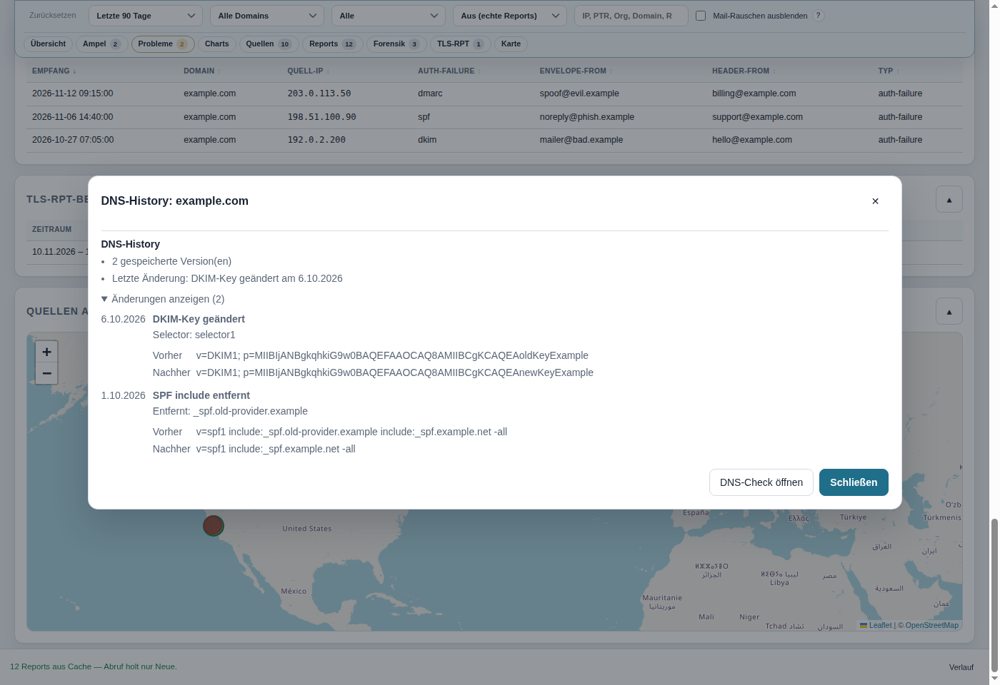
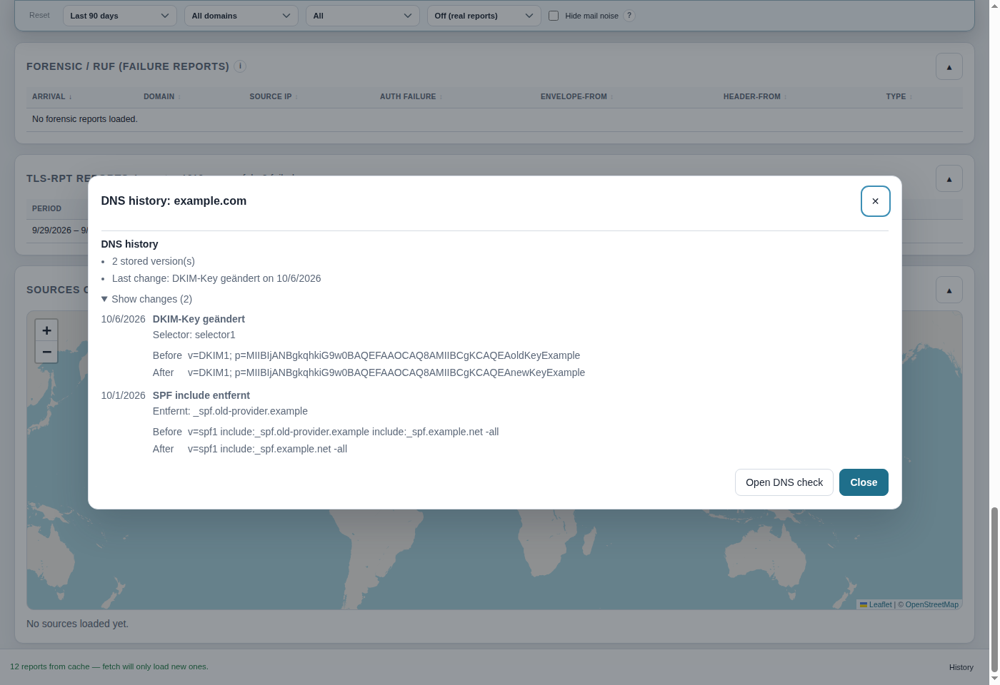

# Changelog

## Unreleased — changes since v1.0.44

### English

- Limited **DKIM DNS checks to selectors that provably belong to the domain**: a selector is only checked if its signature passed at least once within the domain-health window or it was added by hand. Selectors seen only in failing signatures (forged mail) are listed as **Unverified** and no longer turn domain health yellow; retired keys drop out on their own. The same selection applies to the DNS check, policy rollout, PDF report, and daily background check. The **DKIM** tab of the domain settings now marks selectors missing in DNS and explains all states in a legend. Cache schema v15 stores passing selectors per record; existing selector entries count as report-discovered, so re-enter a selector that should always be checked.
- Added **RFC 7208 SPF syntax and multi-record validation (`PermError`)**: detects malformed SPF tokens (such as bare hostnames without `a:` or `include:`, invalid dual-CIDR lengths, or invalid domain specs) and multiple published `v=spf1` TXT records, marking domain health as critical (`SPF syntax error (PermError)`), blocking policy rollout (`noSpf`), and surfacing the errors in the DNS check, SPF wizard live-DNS card, lookup tree (`PermError (invalid)`), and optimizer.
- Filtered **report-discovered DKIM selectors** to signatures whose `<dkim><domain>` is relaxed-aligned with the `header_from` or policy domain (and preferred aligned signatures for `dkimDomain` / `dkimRawResult` when a message carries multiple DKIM signatures), preventing foreign forwarder selectors from triggering false “DKIM selector missing in DNS” warnings in domain health and DNS checks.
- Added **Google OAuth client secret** support for the desktop PKCE flow (stored encrypted via `safeStorage` or read from `DMARC_GOOGLE_CLIENT_SECRET`), required by Google when exchanging or refreshing desktop OAuth tokens.
- Added **dashboard UX improvements**: interactive KPI tiles that jump to the corresponding section and show previous-period delta badges (`Fail` and `Pass rate` for 7/30/90-day windows), a fast indexed search bar (`Ctrl+F` / `/`) across all breakdown tables, problem sources, reports, and forensic rows, a section jump bar with live count badges in the filter panel, and automatic collapsing of empty Forensic / TLS-RPT widgets.
- Added **report retention and configuration backup** in a dedicated **Retention & backup** settings tab: optionally prunes expired aggregate, forensic, and TLS-RPT reports after N days (on startup, after fetches, or manually while preserving IMAP UID watermarks, known source IPs, sending services, and DNS history) and exports/imports configuration backups (accounts without secrets, global settings, sending services, and domain DKIM selectors) as JSON.
- Added an **SPF lookup tree and optimizer** to the SPF record wizard: visualizes RFC 7208 DNS lookup costs per mechanism (`include:`, `redirect=`, `a`, `mx`, `ip4:`, `ip6:`, `exists:`, `ptr`) with a 10-lookup budget bar and flags duplicate/nested includes, redundant or already-covered CIDR ranges, empty `a`/`mx` mechanisms, deprecated `ptr`, and `+all`/`~all`.
- Added an **All accounts** combined dashboard view in the toolbar when multiple IMAP accounts are configured, aggregating cached reports, fetching across all accounts sequentially, and prompting for the target account (or shared local store) when importing report files.
- Updated the domain health traffic-light cache (`dns_health_cache`) immediately whenever a live DNS check runs (manual DNS check, rollout assistant, record wizards, or daily background check) and added an **Open DNS check** button to the DNS history dialog.
- Properly ad-hoc signed macOS `.app` bundles (`identity: '-'` + `com.apple.security.cs.disable-library-validation`) so Apple Silicon (`arm64`) builds pass signature verification without `Apparency` errors.
- Added deeper DKIM key inspection in the DNS check: detects revoked keys (`p=` empty), key algorithm (`rsa` / `ed25519`), RSA modulus length in bits (warning on keys ≤ 1024 bits), and testing mode (`t=y`).
- Added live BIMI asset validation: checks the SVG logo (`l=`) against the SVG Tiny Portable/Secure (SVG Tiny PS) profile (≤ 32 KB, `baseProfile="tiny-ps"`, `<title>`, no scripts or forbidden elements) and validates the VMC/CMC certificate (`a=`) expiration window.
- Added DNSSEC `AD`-bit validation and RFC 1035 TCP fallback (`TC=1`) to DANE/TLSA lookups, warning when TLSA records are published without DNSSEC.
- Added local cryptographic DKIM signature verification (`bh=` body hash and `b=` signature verified against live `_domainkey` DNS keys) to the **Inspect email** tool.
- Improved IMAP fetch robustness: tracks mailbox `UIDVALIDITY` (resetting the UID watermark if a folder is recreated) and includes `TLS-RPT` / `TLS Report` subjects in the default search filter.
- Capped concurrent IP enrichment lookups (`IP_ENRICHMENT_CONCURRENCY = 8`), reduced `dns:healthBatch` IPC payload to pre-aggregated domain stats, and restricted `disableHardwareAcceleration` / `--disable-gpu` workarounds to Linux.
- Modularized `src/shared/i18n.ts` (`locales/de.ts`, `locales/en.ts`), `src/main/cache.ts` (`cache-dns.ts`, `cache-enrichment.ts`), and `src/renderer/src/view.ts` (`domain-settings-modal.ts`, `diagnosis-modal.ts`, `tlsrpt-view.ts`).
- Added permanent per-domain DNS and transport history, recording snapshots and detecting DMARC, SPF, DKIM, BIMI, TLS-RPT, and MTA-STS changes.
- Added automatic daily DNS and transport checks for domains found in saved DMARC reports. Existing recent checks are reused, and failures are logged and reported.
- Added a per-domain info button in the domain health list to open DNS history, including event dates and before/after values. The history is also available from the DNS check view.
- Refined report correlations to reflect the latest DNS drift and the latest DMARC report, avoiding stale alerts when the fail rate has recovered.
- Updated vulnerable transitive development dependencies: `http-cache-semantics` to 4.3.0 and `source-map-js` to 1.2.2; overrode `roarr` to 3.1.3 to remove vulnerable `sprintf-js`.

### Deutsch

- **DKIM-DNS-Prüfung auf nachweislich eigene Selektoren beschränkt**: Ein Selektor wird nur geprüft, wenn seine Signatur im Ampel-Zeitraum mindestens einmal gültig war oder er von Hand eingetragen wurde. Selektoren, die nur in ungültigen Signaturen vorkamen (gefälschte Mails), erscheinen als **Unbestätigt** und färben die Domain-Ampel nicht mehr gelb; abgelöste Schlüssel fallen von selbst heraus. Dieselbe Auswahl gilt für DNS-Check, Policy-Rollout, PDF-Report und den täglichen Hintergrund-Check. Der Tab **DKIM** der Domain-Einstellungen markiert jetzt im DNS fehlende Selektoren und erklärt alle Zustände in einer Legende. Cache-Schema v15 speichert gültige Selektoren je Record; bestehende Selektor-Einträge gelten als „aus Reports“ – einen Selektor, der immer geprüft werden soll, einmal neu eintragen.
- **SPF-Syntax- und Mehrfach-Record-Prüfung nach RFC 7208 (`PermError`)** ergänzt: erkennt ungültige SPF-Mechanismen/Tokens (z. B. nackte Hostnamen ohne `a:` oder `include:`, fehlerhafte Dual-CIDR-Präfixe oder ungültige Domain-Specs) sowie mehrere veröffentlichte `v=spf1`-TXT-Records, stuft die Domain-Ampel als kritisch ein (`SPF-Syntaxfehler (PermError)`), blockiert den Policy-Rollout (`noSpf`) und zeigt die Fehler im DNS-Check, in der Live-DNS-Karte des SPF-Wizards, im Lookup-Baum (`PermError (ungültig)`) und im Optimierer an.
- **DKIM-Selektor-Erkennung aus Reports bereinigt**: übernimmt nur noch `<dkim>`-Signaturen aus `<auth_results>`, deren Domain (relaxed) mit `header_from` bzw. der Report-Domain aligned ist (und bevorzugt bei mehrfach signierten Mails die eigene Signatur für `dkimDomain` / `dkimRawResult`), sodass fremde Weiterleiter-Selektoren keine falschen Gelb-Warnungen („DKIM-Selektor fehlt im DNS") in der Domain-Ampel auslösen.
- **Google OAuth Client-Secret** für den Desktop-PKCE-Flow unterstützt (lokal verschlüsselt über `safeStorage` oder per `DMARC_GOOGLE_CLIENT_SECRET`), das Google beim Token-Austausch und Token-Refresh von Desktop-OAuth-Clients verlangt.
- **Dashboard-Bedienung erweitert**: klickbare KPI-Kacheln zum direkten Springen in die jeweilige Sektion inkl. Vorzeitraum-Delta (`Fail` und `Pass-Rate` bei 7/30/90 Tagen), schnelle indizierte Volltextsuche (`Ctrl+F` / `/`) über Problemquellen, Quell-IPs, Organisationen, From-Domains, Einzelreports und Forensik, eine Schnellnavigations-Leiste (Jump-Bar) mit Live-Zählern in der Filterleiste sowie automatisches Einklappen leerer Forensik-/TLS-RPT-Sektionen.
- **Report-Aufbewahrung & Konfigurations-Backup** in einem eigenen Einstellungs-Tab **Aufbewahrung & Backup** ergänzt: bereinigt abgelaufene Aggregate-, Forensik- und TLS-RPT-Reports optional nach X Tagen automatisch (beim Start, nach jedem Abruf oder manuell — unter Erhalt von IMAP-UIDs, bekannten Quell-IPs, Sende-Diensten und DNS-History) und exportiert/importiert die gesamte Konfiguration (Konten ohne Geheimnisse, globale Einstellungen, Sende-Dienste und Domain-DKIM-Selektoren) als JSON-Datei.
- **SPF-Lookup-Baum & Optimierer** im SPF-Wizard ergänzt: zeigt die DNS-Lookup-Kosten nach RFC 7208 pro Mechanismus (`include:`, `redirect=`, `a`, `mx`, `ip4:`, `ip6:`, `exists:`, `ptr`) als Baumansicht samt 10-Lookup-Budgetbalken und erkennt doppelte/verschachtelte Includes, redundante oder bereits abgedeckte IP-Netze, leere `a`/`mx`-Mechanismen, veraltetes `ptr` sowie `+all`/`~all`.
- Kontoübergreifende Gesamtansicht (**Alle Konten**) in der Toolbar ergänzt (ab zwei eingerichteten IMAP-Konten): führt gecachte Reports aller Konten zusammen, ruft bei Klick auf „Reports abrufen" alle Postfächer nacheinander ab und fragt beim Datei-Import das Zielkonto (oder den lokalen Import-Speicher) ab.
- Domain-Ampel (`dns_health_cache`) wird nach jedem Live-DNS-Check (manuell, Policy-Rollout, Wizards, täglicher Hintergrund-Check) sofort aktualisiert; außerdem führt im DNS-History-Dialog ein Button direkt zum DNS-Check der Domain.
- macOS-Builds werden im Release-Workflow sauber ad-hoc-signiert (`identity: '-'` + `com.apple.security.cs.disable-library-validation`), sodass Apple-Silicon-Builds (`arm64`) keine Signaturfehler mehr melden.
- Tiefere DKIM-Schlüsselprüfung im DNS-Check ergänzt: erkennt widerrufene Schlüssel (`p=` leer), Algorithmus (`rsa` / `ed25519`), RSA-Schlüssellänge in Bit (Warnung bei ≤ 1024 Bit) und den Testmodus (`t=y`).
- Live-Validierung für BIMI ergänzt: prüft das SVG-Logo (`l=`) gegen das SVG-Tiny-PS-Profil (≤ 32 KB, `baseProfile="tiny-ps"`, `<title>`, keine Skripte/verbotenen Elemente) sowie das VMC-/CMC-Zertifikat (`a=`) auf seinen Gültigkeitszeitraum.
- DANE/TLSA-Abfragen um TCP-Fallback bei gesetztem Truncated-Bit (`TC=1`) und Prüfung des DNSSEC-`AD`-Flags erweitert (inkl. Warnung bei unsignierten TLSA-Einträgen).
- Lokale kryptografische DKIM-Signaturprüfung (`bh=`-Body-Hash und `b=`-Signatur gegen den live aufgelösten `_domainkey`-DNS-Eintrag) in **E-Mail prüfen** ergänzt.
- IMAP-Abruf gehärtet: speichert `UIDVALIDITY` je Postfach/Archivordner (setzt `lastUid` zurück, falls der Server den Ordner neu anlegt) und berücksichtigt `TLS-RPT`- / `TLS Report`-Betreffs im Standard-Suchfilter.
- Parallelität der IP-Anreicherung begrenzt (`IP_ENRICHMENT_CONCURRENCY = 8`), IPC-Payload für `dns:healthBatch` auf voraggregierte Domain-Statistiken reduziert und die Flags `disableHardwareAcceleration` / `--disable-gpu` auf Linux beschränkt.
- Große Module aufgeteilt: `src/shared/i18n.ts` (`locales/de.ts`, `locales/en.ts`), `src/main/cache.ts` (`cache-dns.ts`, `cache-enrichment.ts`) und `src/renderer/src/view.ts` (`domain-settings-modal.ts`, `diagnosis-modal.ts`, `tlsrpt-view.ts`).
- Dauerhafte DNS- und Transport-History pro Domain ergänzt. DNS-Snapshots werden gespeichert; Änderungen an DMARC, SPF, DKIM, BIMI, TLS-RPT und MTA-STS werden erkannt.
- DNS- und Transport-Checks laufen automatisch täglich für Domains aus gespeicherten DMARC-Reports. Kürzlich geprüfte Domains werden übersprungen; Fehler werden protokolliert und gemeldet.
- Ein Info-Button an jeder Domain in der Domain-Ampel öffnet die DNS-History mit Änderungsdatum sowie Vorher-/Nachher-Werten. Die Historie bleibt auch in der DNS-Check-Ansicht verfügbar.
- Korrelationen berücksichtigen jetzt den letzten DNS-Drift und den neuesten DMARC-Report. So werden überholte Hinweise ausgeblendet, wenn sich die Fail-Rate inzwischen erholt hat.
- Verwundbare transitive Entwicklungs-Abhängigkeiten aktualisiert: `http-cache-semantics` auf 4.3.0 und `source-map-js` auf 1.2.2; `roarr` wird auf 3.1.3 festgelegt und entfernt damit die verwundbare Abhängigkeit `sprintf-js`.

